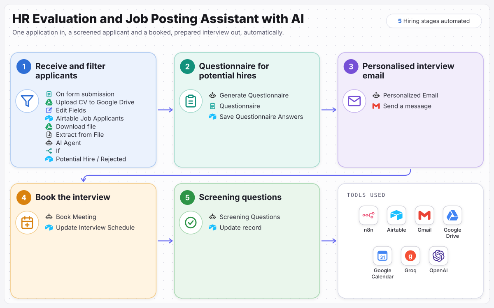

# HR Evaluation and Job Posting Assistant with AI

From application to booked interview without anyone reading a CV first.

Every job application is read against the role it was made for, shortlisted or declined, and recorded. Shortlisted applicants get questions written for the role, a personal interview invite and a booked interview, and the interviewer gets screening questions. Built in n8n.

**Full case study:** [ramonvallejera.com/case-study/hr-evaluation-assistant](https://ramonvallejera.com/case-study/hr-evaluation-assistant)

## How it works

1. Application form
2. CV filed and scored against the role
3. Shortlist or decline
4. Role-specific questions
5. Personal invite
6. Interview booked
7. Screening questions for the interviewer

Built an n8n workflow with five AI steps. The application form saves the CV to Google Drive and the applicant to Airtable, AI reads the CV against the matching job posting and shortlists or declines, shortlisted applicants answer questions written for that role, AI writes a personal interview invite sent from Gmail, books the interview in Google Calendar, and prepares screening questions for the interviewer.

## What's in this repo

| File | What it is |
|---|---|
| `workflow.json` | The n8n workflow, 42 nodes, ready to import |
| `docs/process-map.svg` | The process map from the case study |

Triggers: `On form submission`.

## Set it up

1. In n8n, open **Workflows → Import from File** and choose `workflow.json`.
2. Create these credentials and select them on the nodes that need them:

   - Airtable (personal access token) (12 nodes)
   - Groq (3 nodes)
   - Google Drive (OAuth2) (2 nodes)
   - OpenAI (2 nodes)
   - Gmail (OAuth2) (1 node)
   - Google Calendar (OAuth2) (1 node)

3. Replace the placeholders with your own records:

   - `YOUR_AIRTABLE_BASE_ID` (12×)
   - `YOUR_AIRTABLE_TABLE_ID` (12×): each node keeps the original table name as a hint
   - `YOUR_CALENDAR_ID` (1×)
   - `YOUR_DRIVE_FOLDER_ID` (1×)
   - `YOUR_DRIVE_ID` (1×)
   - `you@example.com` (1×): your calendar or sending address

4. Run it once with test data, then activate it.

Tools: n8n, Airtable, Gmail, Google Drive, Google Calendar, Groq, OpenAI.

## Notes

- Credentials, webhook IDs, pinned test data and account-specific IDs were removed before publishing. n8n assigns new webhook URLs on import.
- Built by [Ramon Vallejera Jr.](https://ramonvallejera.com), AI Automation Engineer. Questions or a build like this for your team: [ramonvallejera.com/contact](https://ramonvallejera.com/contact).
